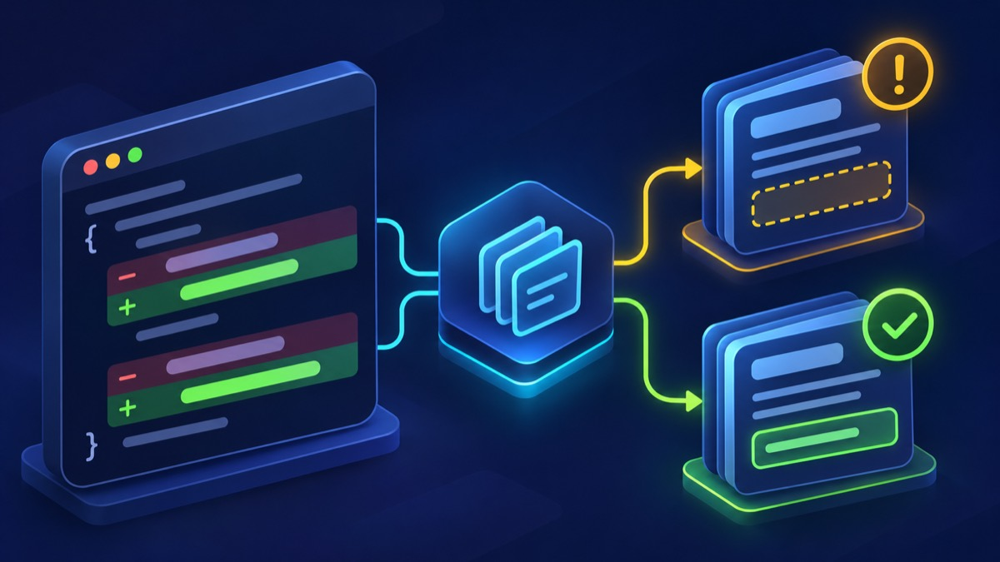
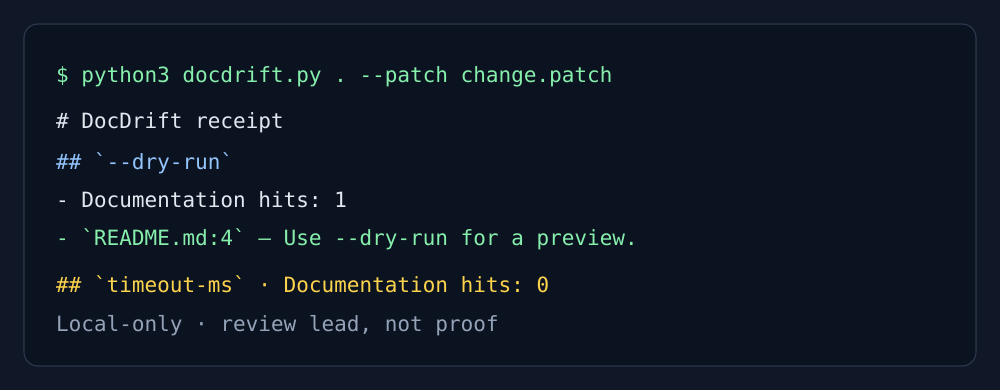

# DocDrift

**A local receipt for public tokens changed in code but missing from docs.**

DocDrift reads a Git diff or patch, identifies changed CLI flags, environment
variables, and simple config keys, then searches README/docs/examples for
matching documentation. It never executes project code or sends source away.



*Conceptual AI-generated workflow illustration. The terminal demo below is the
truthful, reproducible example of DocDrift output.*



```sh
python3 docdrift.py .
python3 docdrift.py . --patch change.patch --json receipt.json
python3 docdrift.py . --strict
python3 -m unittest discover -s tests -v
```

`--strict` exits 2 when a changed token has no documentation text match. This
is a review prompt, not proof that documentation is incomplete or incorrect.

## What it checks

- `--kebab-case` flags
- `UPPER_CASE_ENV` variables
- quoted configuration-like keys
- README, docs/, and examples/ text references

## Limits

It is text matching, not API parsing or documentation validation. A hit can be
stale; no hit can still be adequately documented by different wording.

## License

[MIT](LICENSE)
